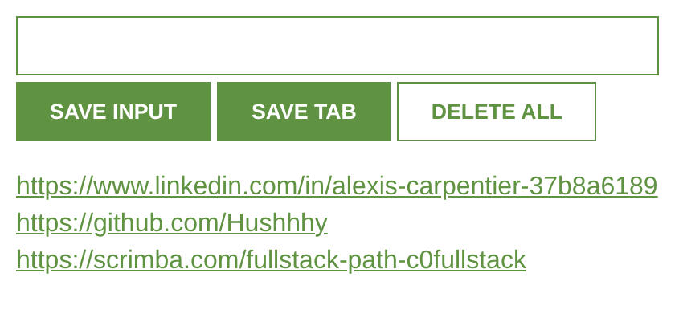

# 📌 Leads Tracker

A Chrome extension to save links to leads in one click: type a URL or save the current tab, and find your list every time you open the extension.

Project from the [Scrimba Fullstack Developer Path](https://scrimba.com/fullstack-path-c0fullstack) (*JavaScript Fundamentals* module).



## ✨ Features

- **SAVE INPUT** saves the link typed in the field
- **SAVE TAB** saves the URL of the current browser tab
- **DELETE ALL** (double-click) clears the whole list
- Saved leads are **clickable** and open in a new tab
- The list is **kept after closing the popup or the browser** thanks to `localStorage`

## 🧩 Install the extension in Chrome

The extension is not on the Chrome Web Store, so you load it from its folder:

1. Download the project: **Code → Download ZIP** on this page, then unzip it, or clone it:
   ```bash
   git clone https://github.com/Hushhhy/simpleChromeExtension.git
   ```
2. Open Chrome and go to `chrome://extensions`.
3. Turn on **Developer mode** (top right).
4. Click **Load unpacked** and select the project folder (the one containing `manifest.json`).
5. Click the puzzle icon 🧩 in the toolbar and **pin** Leads Tracker to keep it at hand.

To update it after a change in the code, click the **reload** icon ↻ on the extension card in `chrome://extensions`.

## 🛠️ Built with

- HTML5
- CSS3
- Vanilla JavaScript (no framework, no library)
- Chrome Extensions API (Manifest V3)

## 🧠 What I practiced

- Creating a Chrome extension with a `manifest.json` and a popup
- Reading the current tab with `chrome.tabs.query()`
- Listening to events with `addEventListener` (`click`, `dblclick`)
- Saving data in the browser with `localStorage`, and converting arrays with `JSON.stringify()` / `JSON.parse()`
- Rendering a list with template strings and `innerHTML`
- Writing functions with parameters (`render(leads)`)
- Using `const` for values that never get reassigned

## 📁 Project structure

```
simpleChromeExtension/
├── manifest.json
├── index.html
├── index.css
├── index.js
├── icon.png
└── images
    └── screenshot.png
```

## 🙏 Credits

- Project brief and design: [Scrimba](https://scrimba.com)
- Built by [Alexis Carpentier](https://github.com/Hushhhy)
